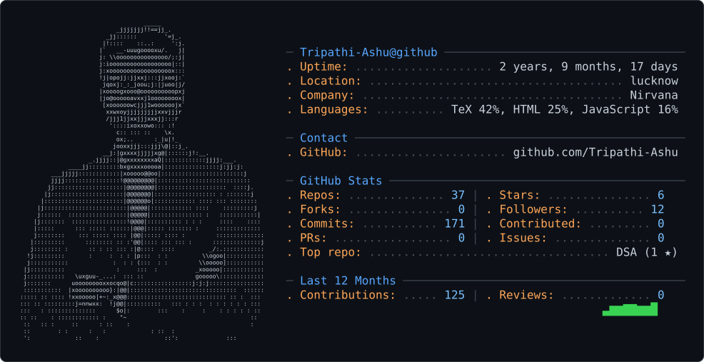

<picture>
  <source media="(prefers-color-scheme: dark)" srcset="dark_mode.svg" />
  <source media="(prefers-color-scheme: light)" srcset="light_mode.svg" />
  
</picture>

# Hi, I'm Ashu Tripathi 👋

**Web Developer & UI/UX Designer** based in **Lucknow, India**.
I build clean, responsive web apps with **React, Node.js and Tailwind**, and design the interfaces in **Figma** before I code them.

- 💼 Associate Software Engineer Trainee at **Nirvana Lab**
- 🎓 B.Tech-2026
- 🏆 Winner, College-level Hackathon 2026
- 🌾 Working on a **Smart India Hackathon (SIH) 2026** problem statement (#32, farmer procurement)

